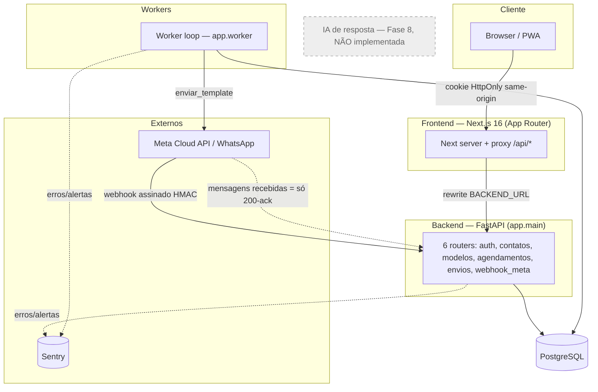
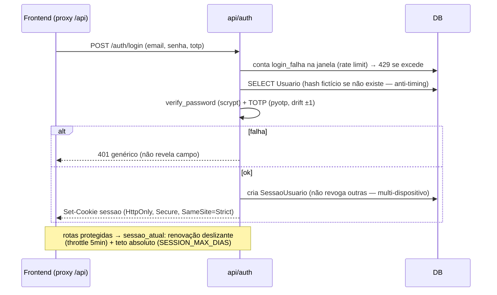

# Codebase Map — Mensageiro

> Gerado pelo Cartographer. Último mapeamento: 2026-11-10.
> Navegação do código — leia **sob demanda**, só a seção necessária. Produto/arquitetura ficam em `BRIEFING.md`; infra em `RAILWAY.md`; interface em `DESIGN-DASHBOARD.md`; regras de trabalho em `CLAUDE.md`.

**Snapshot:** specs 0001–0017 em produção (release #50). Backend Python 3.14 (FastAPI + worker) + frontend Next.js 16. **A resposta com IA ainda não está implementada** — ver [Gotchas](#gotchas).

## System Overview



- **Frontend nunca fala direto com o backend**: tudo passa pelo proxy same-origin do Next (`rewrite /api/:path* → ${BACKEND_URL}/:path*`), que repassa o cookie de sessão. Por isso CORS deixou de ser relevante para auth (ADR 0012).
- **Só o worker inicia mensagens** (invariante §5.1). A API apenas registra agendamentos; nenhum endpoint chama a Meta para disparo (só `POST /modelos/{id}/enviar-teste`, restrito ao número de teste).

## Directory Structure

```
mensageiro-ia/
├── backend/
│   ├── app/
│   │   ├── main.py            # entry da API (FastAPI, monta 6 routers, /health)
│   │   ├── criar_admin.py     # python -m app.criar_admin (cria admin único)
│   │   ├── api/               # routers HTTP (auth, contatos, modelos, agendamentos, envios, webhook_meta)
│   │   ├── services/          # lógica extraída: whatsapp_client, janela, recorrencia, contatos_import
│   │   ├── worker/            # __main__.py (loop) + disparo.py (o coração do envio)
│   │   ├── core/              # config, security, auth_deps, audit, observabilidade, telefone
│   │   ├── models/            # ORM SQLAlchemy (9 tabelas)
│   │   ├── schemas/           # Pydantic (validação de domínio)
│   │   └── db/                # engine/SessionLocal, Base
│   ├── migrations/            # Alembic (10 revisões)
│   └── tests/                 # pytest + PostgreSQL real (25 módulos)
├── frontend/
│   ├── app/                   # App Router: (app)/{hoje,agenda,contatos,modelos,historico,nova-mensagem}, login, layout
│   ├── components/            # GuardaAuth, AppShell, NovaMensagemForm, Selo, Esqueleto, icones…
│   ├── lib/                   # api (cliente), auth (prefs), datas (TZ SP↔UTC), tema
│   └── public/               # manifest PWA, sw.js
├── specs/                     # specs 0001–0017 (contrato de cada feature)
├── docs/                      # BRIEFING, decisões/ADRs, este mapa
├── docker-compose.yml         # Postgres 17 local (127.0.0.1:5434)
└── .github/workflows/ci.yml   # CI: job backend + job frontend
```

## Module Guide

### Backend — `api/` (routers HTTP)

**Propósito:** superfície HTTP. **Entry:** montados em `app/main.py`. Padrão: acesso direto ao `Session` do SQLAlchemy (sem camada de repositório), `db.commit()`+`db.refresh()` após mutação, validação em schemas Pydantic (422 automático).

| Arquivo | Prefixo | Endpoints-chave |
|---|---|---|
| `api/auth.py` | `/auth` | `POST /login` (público, rate limit + scrypt + TOTP), `POST /logout`, `POST /logout-todos`, `GET /me` |
| `api/contatos.py` | `/contatos` | CRUD, `POST /importar` (CSV/XLSX multipart), `/{id}/descadastrar`, `/{id}/consentimento` |
| `api/modelos.py` | `/modelos` | `POST /sincronizar` (Meta), `GET /`, `POST /{id}/enviar-teste` (só número de teste) |
| `api/agendamentos.py` | `/agendamentos` | criar/listar, `/{id}/cancelar`, `/{id}/reenviar`, `/{id}/cancelar-serie` |
| `api/envios.py` | `/envios` | `GET /` (histórico, read-only, join contato+modelo) |
| `api/webhook_meta.py` | `/webhook/meta` | `GET` (handshake), `POST` (statuses + template_status; **público, segurança por HMAC**) |

**Gotchas:** todos os routers autenticados usam `dependencies=[Depends(usuario_atual)]` no `APIRouter` — exceto `modelos.py`, que declara a dependência por função (mesmo efeito). `webhook_meta.py` é o único público.

### Backend — `services/`

| Arquivo | Exports-chave | Nota |
|---|---|---|
| `whatsapp_client.py` | `enviar_template`, `upload_midia`, `listar_templates`, `WhatsappError` | `client: httpx.Client \| None` injetável (mock em teste); retry exp. só em 429/5xx |
| `janela.py` | `dentro_da_janela`, `proximo_inicio`, `inicio_dia_seguinte`, `obter_configuracao` | Janela `[inicio, fim)` em `America/Sao_Paulo`; fonte runtime da config (ADR 0008) |
| `recorrencia.py` | `validar_regra`, `proxima_ocorrencia` | RRULE via `dateutil`; cálculo em SP, retorno UTC |
| `contatos_import.py` | `importar`, `ImportacaoError` | Commit **por linha** (parcial em erro); nunca ressuscita descadastrado; opt-in novo nunca revoga |

### Backend — `worker/` (o coração)

**Entry:** `python -m app.worker` → `__main__.py:executar()` (loop: heartbeat → `processar_ciclo` → sleep `WORKER_INTERVALO_S`, default 60s; exceção vai ao Sentry e o loop segue). **`disparo.py`** é o arquivo mais pesado (~3,9k tokens) e implementa todas as invariantes de envio. Ver [Data Flow](#data-flow) e [Gotchas](#gotchas).

### Backend — `core/`

| Arquivo | Propósito |
|---|---|
| `config.py` | `Settings`/`get_settings()` (`lru_cache`) — ver [Environment Variables](#environment-variables) |
| `security.py` | scrypt (`hash_password`/`verify_password`), token de sessão, Fernet/MultiFernet (`cifrar_segredo`/`decifrar_segredo`) |
| `auth_deps.py` | `sessao_atual`/`usuario_atual` — resolução de sessão por cookie (Bearer removido 2026-11-05) |
| `audit.py` | `registrar_auditoria()` — sessão própria, nunca propaga exceção |
| `observabilidade.py` | `configurar_sentry()`, `alertar_evento()`, `_mascarar_pii` (before_send) |
| `telefone.py` | `normalizar_e164` (phonenumbers), `mascarar_telefone` |

### Backend — `models/`, `schemas/`, `db/`

- `models/`: 9 tabelas ORM (ver [Database Schema](#database-schema)). IDs são `String(36)` UUID gerado em Python. `models/__init__.py` importa tudo para o autogenerate do Alembic.
- `schemas/`: validação de domínio em Pydantic (telefone canônico, XOR contato/grupo, datas não-futuras, caps de tamanho).
- `db/`: `engine`/`SessionLocal` (`expire_on_commit=False`), `Base`, `get_db`.

### Frontend — `app/`, `components/`, `lib/`

**Stack:** Next.js 16 (App Router), React 19, TypeScript estrito, **CSS puro + design tokens** (sem Tailwind/UI lib), Vitest. PWA (manifest + `sw.js`).

| Rota | Propósito |
|---|---|
| `/login` | Login e-mail + senha + TOTP |
| `(app)/hoje` | Dashboard (3 de 4 indicadores ainda stub "—") |
| `(app)/agenda` | Gestão de agendamentos (cancelar/reenviar/cancelar série) |
| `(app)/contatos` | CRUD + consentimento + descadastro + importar CSV/XLSX |
| `(app)/modelos` | Templates (read-only) + sincronizar com a Meta |
| `(app)/historico` | Envios (read-only) com filtros |
| `(app)/nova-mensagem` | `NovaMensagemForm` — agendar envio avulso |

- `components/GuardaAuth.tsx`: chama `GET /api/auth/me`; falhou → `/login`; ok → `AppShell`. Grupo de rotas `(app)` fica sob essa guarda.
- `lib/api.ts`: `BASE = "/api"`, toda `fetch` com `credentials:"include"` (cookie HttpOnly, **sem token em JS**); `ApiError` preserva `status` (401 → `router.replace("/login")`).
- `lib/datas.ts`: `saoPauloParaIso` converte horário de parede SP → UTC. `lib/tema.ts`: claro/escuro/sistema (anti-flash). `lib/auth.ts`: só prefs de login (e-mail; senha em texto puro no localStorage se "Lembrar" — débito aceito).

## Data Flow

### 1. Worker — disparo agendado

```mermaid
sequenceDiagram
    participant Loop as worker/__main__
    participant Ciclo as disparo.processar_ciclo
    participant DB as PostgreSQL
    participant Meta as whatsapp_client

    Loop->>Ciclo: processar_ciclo(heartbeat, intervalo)
    Ciclo->>DB: obter_configuracao (pausa/janela/limites)
    alt envios_pausados
        Ciclo-->>Loop: return
    end
    Ciclo->>DB: SELECT agendamentos vencidos (status in aprovado/enviando) LIMIT 100
    loop por agendamento
        Ciclo->>DB: SELECT ... FOR UPDATE SKIP LOCKED (claim)
        alt fora da janela
            Ciclo->>DB: status=aprovado, executar_em=proximo_inicio
        else modelo != aprovado
            Ciclo->>DB: status=falhou (alerta)
        else limite diário global atingido
            Ciclo->>DB: adia p/ inicio_dia_seguinte
        else ok
            Ciclo->>DB: status=enviando + COMMIT (libera lock antes do INSERT FK)
            loop por contato (corte pelo teto por-agendamento)
                Ciclo->>DB: INSERT envios ON CONFLICT (agendamento_id, contato_id) DO NOTHING
                alt reservou (não existia)
                    Ciclo->>Meta: enviar_template → wamid
                    Ciclo->>DB: Envio.status=enviado | falhou(+alerta)
                end
            end
            opt recorrente
                Ciclo->>DB: INSERT próxima ocorrência ON CONFLICT (pai, executar_em)
            end
            Ciclo->>DB: status=enviado (ou parcial se cortou pelo teto)
        end
    end
    Ciclo->>DB: gravar heartbeat (saude.ultimo_ciclo_em)
```

**Idempotência (invariante §5.2):** a reserva `INSERT ... ON CONFLICT DO NOTHING` no índice único parcial `(agendamento_id, contato_id)` acontece **antes** de chamar a Meta. Reinício no meio de um lote reprocessa sem reenviar. Consentimento e descadastro são checados por contato, a cada ciclo.

### 2. Webhook da Meta

```mermaid
sequenceDiagram
    participant Meta
    participant WH as api/webhook_meta
    participant DB

    Meta->>WH: POST /webhook/meta (corpo + X-Hub-Signature-256)
    WH->>WH: body cru → HMAC-SHA256(APP_SECRET) compare_digest
    alt assinatura inválida
        WH-->>Meta: 403
    else válida
        WH->>WH: json.loads (inválido → 200 "ignorado")
        alt statuses
            WH->>DB: SELECT Envio WHERE wamid; avança status por monotonicidade (_RANK)
        else template_status
            WH->>DB: UPDATE Modelo.status; pausado/rejeitado → auditoria+alerta
        else messages recebidas
            WH-->>Meta: 200-ack (conteúdo NÃO processado — Fase 8)
        end
        WH-->>Meta: 200 ok
    end
```

### 3. Auth / login



## Database Schema

9 tabelas. IDs `String(36)`. Ver `backend/app/models/` e `backend/migrations/`.

| Tabela | Colunas-chave | FKs |
|---|---|---|
| `usuarios` | `email` UNIQUE, `senha_hash`, `totp_secret` (cifrado), `ativo` | — |
| `sessoes_usuario` | `token` UNIQUE, `expira_em`, `revogada`, `ultimo_uso_em`, `user_agent` | `usuario_id → usuarios.id` |
| `auditoria` | `operacao` idx, `ator_email` idx, `status`, `metadados`, `correlation_id` idx | — (imutável, desacoplado) |
| `saude` | `ultimo_ciclo_em` (heartbeat, linha `id="worker"`) | — |
| `contatos` | `telefone_e164` UNIQUE, `consentimento`(+data/origem), `descadastrado_em`, `tags` JSONB | — |
| `modelos` | `(nome, idioma)` UNIQUE, `categoria`, `status`, `corpo`, `variaveis` JSONB | — |
| `envios` | `wamid` UNIQUE, `status`, `pricing`/`conversation` JSONB, `erro_codigo/motivo` | `contato_id`, `modelo_id`, `agendamento_id` |
| `agendamentos` | `executar_em`, `status`, `recorrencia` (RRULE), `agendamento_pai_id`, `reagendamentos` | `contato_id`, `modelo_id`, `criado_por`, `aprovado_por` |
| `configuracoes` | linha única `id="default"`: `janela_envio` JSONB, `limite_diario`, `limite_por_contato_dia`, `limite_por_agendamento_dia`, `envios_pausados` | — |

**Constraints críticas:**
- `uq_envios_agendamento_contato` — índice único **parcial** em `(agendamento_id, contato_id) WHERE agendamento_id IS NOT NULL` → chave de idempotência do worker (não trava envios avulsos/teste).
- `ck_agendamentos_contato_xor_grupo` — CHECK `(contato_id IS NOT NULL) <> (grupo IS NOT NULL)`.
- `uq_agendamentos_serie_ocorrencia` — índice único parcial em `(agendamento_pai_id, executar_em)` → dedup de ocorrências recorrentes.

**Cadeia Alembic (10 revisões):** `50b244c235c2` (base vazia) → `ab30d72b78e4` (usuarios/sessoes/auditoria) → `58eccad8f930` (sessão multi-dispositivo) → `c6ab526dae96` (saude) → `60e87808c17a` (contatos) → `a6c885be3f81` (modelos+envios) → `5d75fec0aa05` (agendamentos+configuracoes, seed da config) → `4ff11dacdb87` (índice série/ocorrência) → `c4c7ff4e9646` (cifra totp_secret — roda código de domínio) → `4a3dc85cbaa2` (0016: `limite_por_agendamento_dia`).

## Environment Variables

De `backend/app/core/config.py` (`Settings`, lida de `.env`). Segredos nunca têm default real.

| Variável | Uso |
|---|---|
| `DATABASE_URL` | conexão Postgres (dev local `:5434`) |
| `WHATSAPP_TOKEN`, `PHONE_NUMBER_ID`, `WABA_ID` | Meta Cloud API (envio, templates) |
| `APP_SECRET` | HMAC do webhook |
| `WEBHOOK_VERIFY_TOKEN` | handshake `GET /webhook/meta` |
| `GRAPH_API_VERSION` | default `v26.0` |
| `WHATSAPP_TEST_NUMBER` | allowlist de `enviar-teste` |
| `SENTRY_DSN` | observabilidade |
| `SESSION_INATIVIDADE_DIAS` (7), `SESSION_MAX_DIAS` (30), `SESSION_THROTTLE_MIN` (5) | sessão |
| `LOGIN_MAX_TENTATIVAS` (5), `LOGIN_JANELA_MIN` (15) | rate limit de login |
| `WORKER_INTERVALO_S` (60) | loop do worker |
| `LIMITE_DIARIO` (200), `LIMITE_POR_AGENDAMENTO` | **seed** da config (runtime vem da tabela `configuracoes`) |
| `IMPORT_MAX_BYTES` (5 MiB), `IMPORT_MAX_LINHAS` (5000) | upload de contatos |
| `TOTP_ENC_KEY` | chave(s) Fernet (MultiFernet) p/ `totp_secret` |
| `ADMIN_EMAIL`, `ADMIN_PASSWORD` | `criar_admin.py` |
| `FRONTEND_URL` | CORS no backend |
| `BACKEND_URL` | **frontend** (`next.config.mjs` rewrite `/api/*`) — sem ela, não há proxy |
| `OPENAI_API_KEY`, `OPENAI_MODEL`, `VAPID_*`, `RESEND_API_KEY`, `EMAIL_*`, `API_URL`, `ADMIN_WHATSAPP_NUMBERS` | **declaradas/reservadas, não consumidas** no código atual |

## Conventions

- **Nomes de domínio em português** (contatos, agendamentos, envios); termos técnicos em inglês. Comentários referenciam specs/ADRs (`spec 00NN`, `ADR 00NN`) — forte rastreabilidade código↔`specs/`/`docs/decisoes/`.
- **IDs UUID como string**, gerados em Python antes do insert (nunca `server_default`).
- **SQLAlchemy 2.x estilo Core-em-ORM** (`select()`/`update()`); `expire_on_commit=False`.
- **Validação de domínio nos schemas Pydantic**, não nas rotas.
- **mypy estrito** em `app.services.*` e `app.worker.*` (rigor onde o domínio é crítico); `ruff` line-length 110, ignora `migrations/versions`.
- **Datas** sempre `timestamptz`; cálculo em `America/Sao_Paulo`, exibição idem.
- **Frontend:** App Router com grupo `(app)` autenticado; CSS puro + tokens (sem cor hardcoded fora do arquivo de tokens); skeleton/`EstadoVazio` em vez de spinner; toda chamada trata 401 → `/login`; corpos de template renderizados como texto (React escapa).
- **Testes:** PostgreSQL real em container (nunca SQLite); Meta/OpenAI sempre mockados (invariante §5.7). Cobertura mínima 90% (`--cov-fail-under=90`).

## Gotchas

- **IA de resposta não existe no código.** `OPENAI_API_KEY`/`OPENAI_MODEL` são placeholders; o webhook faz só 200-ack de mensagens recebidas (`api/webhook_meta.py`, comentário "Fase 8"). `Contato.ultima_mensagem_recebida_em` existe no modelo mas nada escreve nele. Não documente fluxo de IA como implementado.
- **Ordem do commit no worker:** `status=enviando` é commitado **antes** do `INSERT` em `envios` para liberar o `FOR UPDATE` (o INSERT pega lock na linha pai via FK). Crash após esse ponto deixa o agendamento em `enviando`; o próximo ciclo reprocessa (idempotente).
- **`sessao_atual` escreve numa dependência de leitura:** pode revogar (teto absoluto) ou renovar (`ultimo_uso_em`/`expira_em`) com `db.commit()` dentro de uma dependência FastAPI.
- **`_mascarar_pii` descarta o evento inteiro** se o scrub de PII falhar — nunca deixa vazar telefone/token ao Sentry.
- **`conftest.py` TRUNCATE lista as tabelas explicitamente:** toda tabela de domínio nova precisa entrar nessa lista, senão o isolamento entre testes quebra silenciosamente.
- **Migração `c4c7ff4e9646` roda código de domínio** (`cifrar_segredo`): import tardio, só exige `TOTP_ENC_KEY` se houver linhas a cifrar.
- **CI sem SAST dedicado:** `ci.yml` roda `pip-audit` + `npm audit`, mas não há job CodeQL/Semgrep no workflow (skills locais existem). O `/seguranca` cobre o diff manualmente.
- **`correlation_id` não é por requisição:** na prática reaproveita o ID do agendamento/série; não há middleware HTTP gerando correlation_id.
- **Senha em texto puro no localStorage** (frontend `lib/auth.ts`) se o usuário marcar "Lembrar senha" — débito técnico aceito e avisado na UI.

## Navigation Guide

- **Novo endpoint HTTP:** criar/editar router em `backend/app/api/`, schema em `backend/app/schemas/`, montar em `app/main.py`, adicionar `Depends(usuario_atual)`, teste em `backend/tests/`.
- **Mexer no disparo/worker:** `backend/app/worker/disparo.py` (+ `services/janela.py`, `services/recorrencia.py`); teste de borda em `backend/tests/test_worker_disparo.py`. **Exige aprovação** se tocar regras de envio (§4 CLAUDE.md).
- **Nova migração:** skill `/migracao`; `alembic revision --autogenerate`, `downgrade` funcional; adicionar tabela nova ao TRUNCATE do `conftest.py`.
- **Mexer em auth:** `backend/app/api/auth.py` + `core/auth_deps.py` + `core/security.py`; frontend `components/GuardaAuth.tsx` + `lib/api.ts`.
- **Nova tela no frontend:** rota em `frontend/app/(app)/`, componente em `frontend/components/`, chamada em `frontend/lib/api.ts`, teste `*.test.tsx` ao lado.
- **Template/webhook/custos da Meta:** skill `/meta-whatsapp`; `services/whatsapp_client.py` + `api/webhook_meta.py` + `api/modelos.py`.

---

If cartographer helped you, consider starring: https://github.com/kingbootoshi/cartographer - please!
